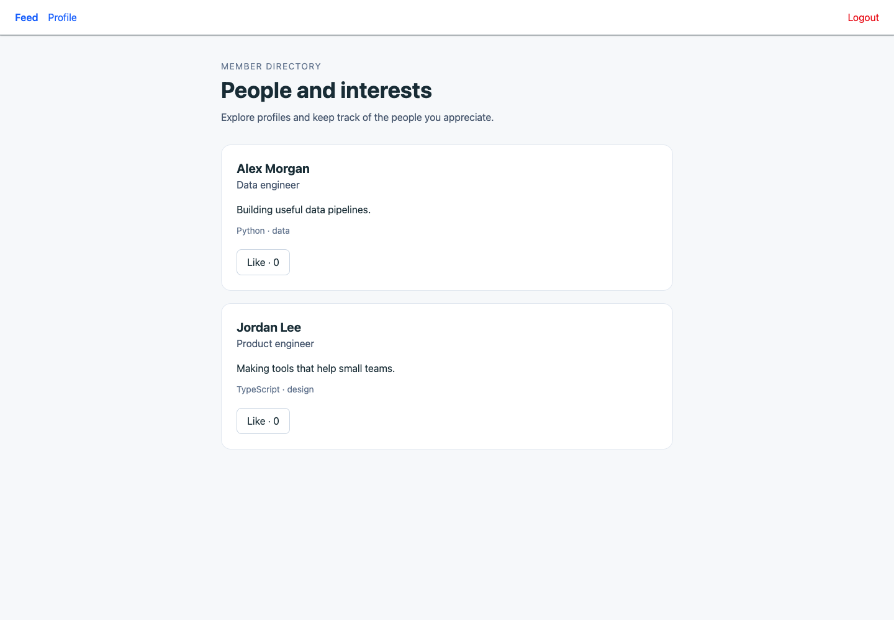

# Member profiles and a small social feed

A React/RTK Query interface backed by Express, Prisma, and PostgreSQL. Members can create a profile, add a photo, browse other profiles, and like or unlike them. The feed is available to signed-in members; it is not an anonymous public directory.



This is a local full-stack exercise. It demonstrates multipart forms, authenticated API calls, a paged feed, and request failure handling. It does not provide a production identity service, a recommendation engine, or a moderation system.

## Two applications, one flow

```text
React + RTK Query → Express authentication/profile routes → Prisma → PostgreSQL
                                ↳ bounded JPEG/PNG uploads → local uploads directory
```

- `frontend/src/services/api.ts` centralizes requests and response types. Tokens are read at request time.
- `frontend/src/features/feed/Feed.tsx` merges pages by profile ID, disables a pending like, and updates the count only after a successful mutation.
- `backend/src/security.ts` requires a private signing key and checks HS256 tokens with a one-hour expiry.
- `backend/src/middleware/uploadMiddleware.ts` limits a photo to 2 MiB, accepts JPEG/PNG signatures, and generates its storage name.

Profile saves and deletes call RTK Query's `unwrap()`, so failed HTTP requests enter the error path. A failed save keeps the draft and shows a message instead of displaying a success banner.

## Local setup

Use Node and a dedicated PostgreSQL database. From `backend`:

```sh
npm ci --ignore-scripts
cp .env.sample .env
node -e "console.log(require('node:crypto').randomBytes(32).toString('hex'))"
```

Set `DATABASE_URL` to your local database and `JWT_SECRET` to the generated private value, at least 32 characters. Dependency installation skips package scripts; native bcrypt may need a reviewed platform binary or build before running the authentication routes.

```sh
npx prisma generate
npx prisma migrate deploy
npm run dev
```

The API binds to `127.0.0.1:3001`. `FRONTEND_ORIGIN` defaults to `http://localhost:5173`. In `frontend`:

```sh
npm ci --ignore-scripts
cp .env.example .env
npm run dev
```

Open the frontend, sign up, save your profile, then visit Feed. `VITE_API_URL` defaults to `http://localhost:3001/api` and is fixed at build time.

## API surface

| Request | Purpose |
| --- | --- |
| `POST /api/auth/signup`, `POST /api/auth/login` | Email/password authentication; return token and user ID |
| `GET /api/profile/me` | Current member's profile |
| `POST /api/profile` | Multipart fields: name, headline, bio, comma-separated interests, optional photo |
| `DELETE /api/profile` | Delete the current profile |
| `GET /api/profile/feed?page=1&limit=5` | Other members; page 1–99999, limit 1–50 |
| `POST /api/profile/:id/like`, `DELETE /api/profile/:id/unlike` | Like and unlike a profile |

Protected endpoints require `Authorization: Bearer <token>`. Profile fields are bounded to 100/200/2000/1000 characters respectively. Authentication requires a valid email and a password of at least eight characters and at most 72 UTF-8 bytes.

## Verification and remaining work

Backend: `npm run typecheck` and `node -r ts-node/register --test test/security.test.cjs`. The focused tests cover token identity/expiry, input boundaries, rejected markup and oversize uploads, a synthetic PNG upload, and rejected async routes. Frontend: `npm run build`, `npm run lint`, plus Chrome checks using invented profiles and intercepted API responses.

PostgreSQL CRUD, actual bcrypt authentication, concurrent likes, and deletion with related likes were not integration-tested. The current Like schema lacks a database uniqueness constraint, and related-row deletion may fail until a deliberate migration is designed.

Before deployment, review the legacy dependencies, add rate limits and upload quotas, decode/re-encode images in an isolated image pipeline, define retention and remove orphaned photos, and add a database-backed integration suite. Magic bytes are a basic format filter, not full image validation. Uploaded photos are served publicly by URL. Tokens remain in localStorage, so XSS protection and session revocation need further design. Offset pagination can shift as new profiles arrive.

