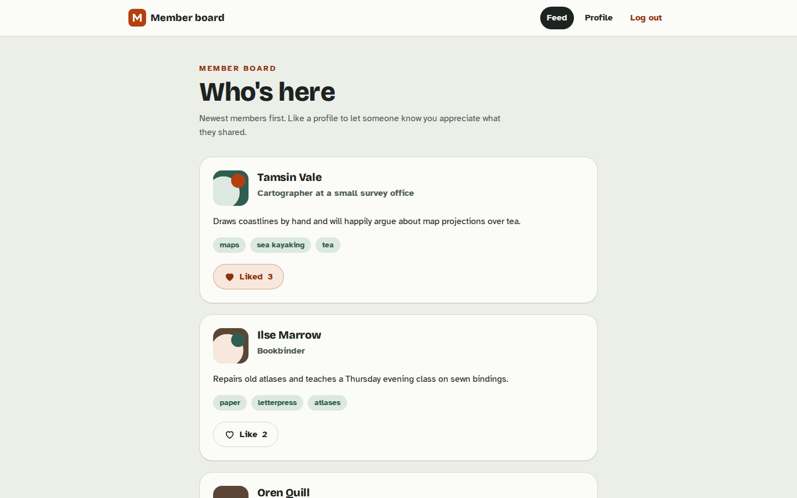
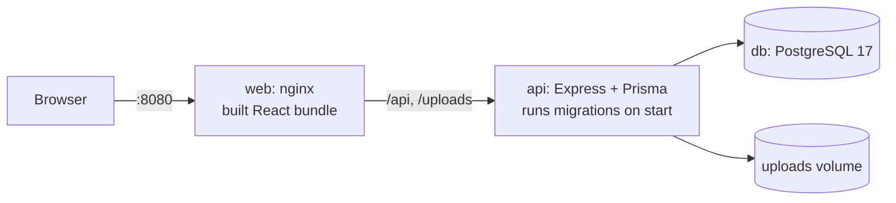
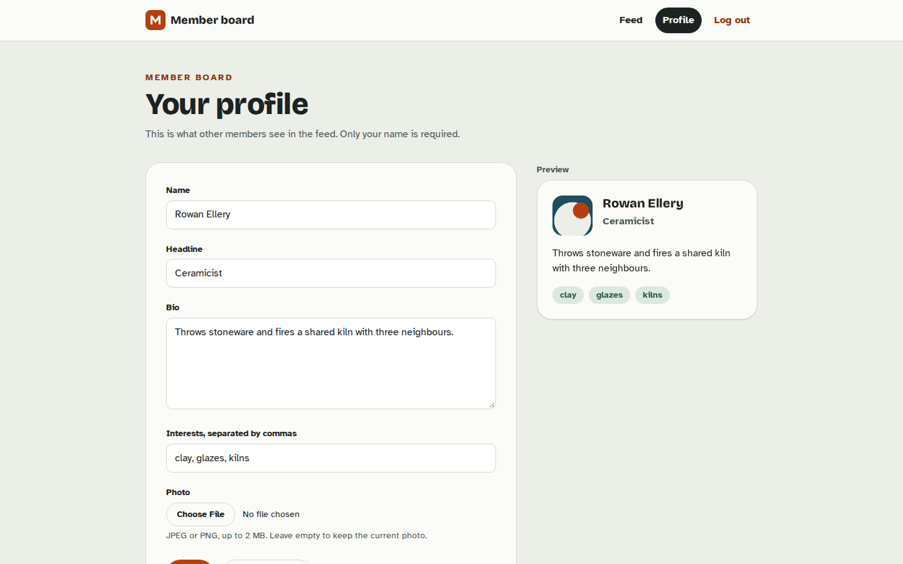
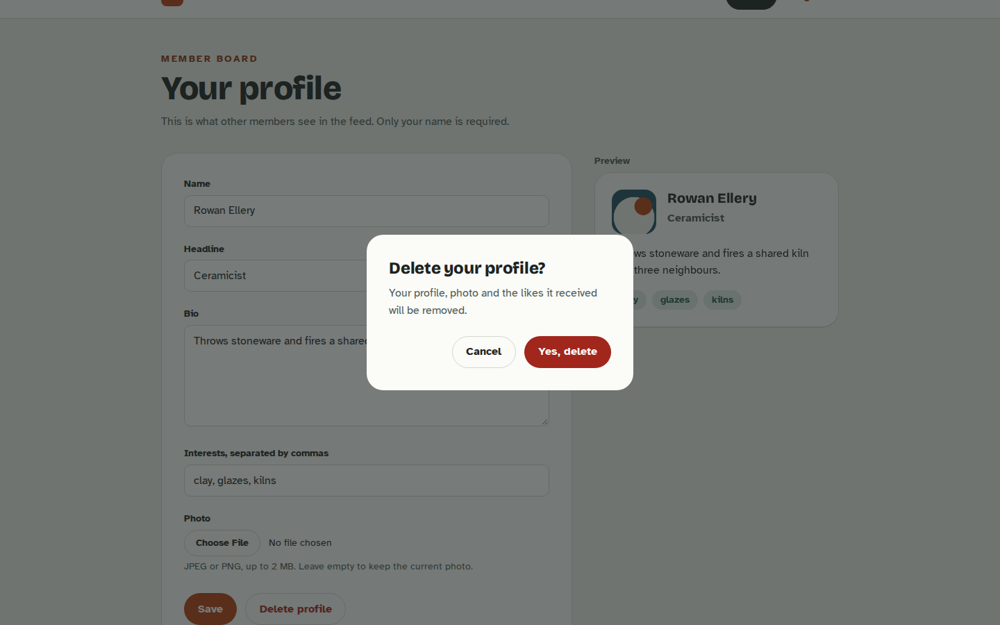
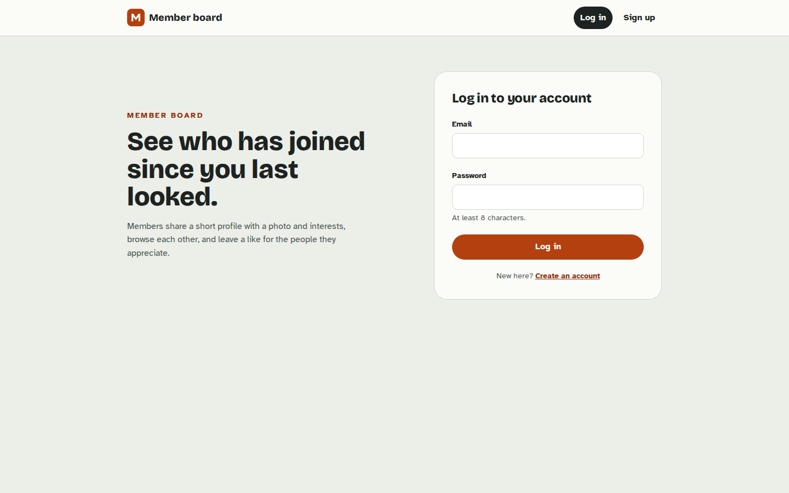
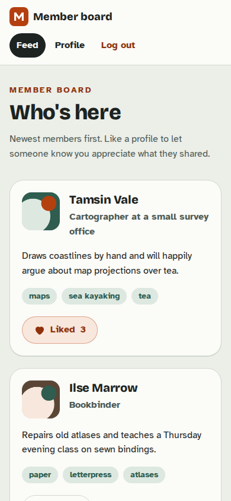
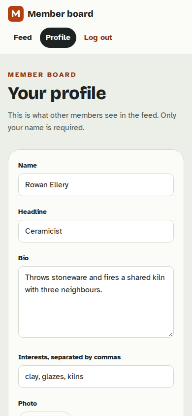

# Member board

A small members-only directory. Each member writes a short profile (name, headline, bio, interests and an optional photo), browses everyone else's newest first, and can like the profiles they appreciate. The feed is only visible after signing in; it is not a public listing.

The frontend is React 19 with Redux Toolkit and RTK Query, styled with Tailwind CSS 4 and built by Vite. The API is Express with Prisma 7 on PostgreSQL. The two run together with one `docker compose up`.



This is a local full-stack project, not a production service. It shows multipart uploads that are checked before anything touches disk, an authenticated paged feed, idempotent likes enforced by the database, and a UI that handles loading, empty, error and expired-session states. It has no moderation, password reset, rate limiting or recommendation logic.

## Running it with Docker Compose

You need Docker with Compose v2.

```sh
cp .env.example .env
# Fill in both values; each can be generated with:
openssl rand -hex 32
docker compose up --build
```

Open http://localhost:8080 (or the `WEB_PORT` you set), create an account, save a profile, then open the feed. A second browser profile or a private window is the quickest way to add another member to like.

`docker compose down` stops the stack; add `-v` to also delete the database and uploaded photos.

What Compose starts:



nginx serves the bundle and forwards `/api` and `/uploads` to the API, so the browser talks to one origin and the bundle is built with `VITE_API_URL=/api`. Only the web port is published. Compose refuses to start until `JWT_SECRET` and `POSTGRES_PASSWORD` are set.

## Running the apps directly

Use Node 22 (`.nvmrc`; the frontend tests need 22.22.2 or later) and a PostgreSQL 14+ database. If you don't have one, this starts a throwaway database:

```sh
docker run --name member-board-db -e POSTGRES_USER=member -e POSTGRES_PASSWORD=<local password> \
  -e POSTGRES_DB=member_profiles -p 5432:5432 -d postgres:17-alpine
```

Backend, from `backend/`:

```sh
npm ci --ignore-scripts
cp .env.example .env    # set DATABASE_URL and a JWT_SECRET of at least 32 characters
npx prisma generate
npx prisma migrate deploy
npm run dev             # API on http://127.0.0.1:3001
```

Installing with `--ignore-scripts` is enough: bcrypt 6 ships prebuilt binaries and Prisma 7 talks to PostgreSQL through the `pg` driver adapter, so nothing has to compile or download an engine at install time.

Frontend, from `frontend/`:

```sh
npm ci --ignore-scripts
cp .env.example .env    # VITE_API_URL defaults to http://localhost:3001/api
npm run dev             # http://localhost:5173
```

`FRONTEND_ORIGIN` in the backend `.env` must match the frontend's origin for CORS.

## Screenshots

All members, names and photos are invented; the photos are generated shapes.

| Profile editor with live preview | Delete confirmation |
| --- | --- |
|  |  |

| Login | Feed on a phone | Profile on a phone |
| --- | --- | --- |
|  |  |  |

## API

Everything under `/api/profile` needs `Authorization: Bearer <token>`. Tokens are HS256 JWTs that expire after one hour.

| Request | Purpose |
| --- | --- |
| `POST /api/auth/signup`, `POST /api/auth/login` | JSON `{ email, password }`; returns `{ token, userId }` |
| `GET /api/profile/me` | Your profile, or 404 if you have not saved one |
| `POST /api/profile` | Create or update your profile (multipart: `name`, `headline`, `bio`, `interests`, optional `photo`) |
| `DELETE /api/profile` | Delete your profile, its photo and the likes it received |
| `GET /api/profile/feed?page=1&limit=5` | Other members, newest first; page 1–99999, limit 1–50 |
| `POST /api/profile/:id/like`, `DELETE /api/profile/:id/unlike` | Like or unlike; both return the new count |
| `GET /api/health` | Liveness check used by the container |

These exchanges were captured from the Compose stack running on port 18930, signed in as the fictional Oren Quill (tokens shortened, JSON reformatted):

```http
POST /api/auth/login
{"email":"oren@example.test","password":"demo-password-1"}

200 {"token":"eyJhbG...8008","userId":"0f03387d-a934-4e23-8eac-7b9beedc2d20"}
```

```http
GET /api/profile/feed?page=1&limit=2

200 [
  {
    "id": "35a9265b-49bf-4714-beb6-8877a00d880b",
    "name": "Rowan Ellery",
    "bio": "Throws stoneware and fires a shared kiln with three neighbours.",
    "headline": "Ceramicist",
    "photoUrl": "http://localhost:18930/uploads/e62ab8fb-a0c2-4402-b8d3-3fffde5e90a8.png",
    "interests": ["clay", "glazes", "kilns"],
    "userId": "2aaaf93b-0513-4b9d-bcfe-b7eb08da566b",
    "createdAt": "2026-11-09T12:48:10.490Z",
    "likeCount": 0,
    "likedByCurrentUser": false
  },
  {
    "id": "37fed175-01f3-475c-ae6c-3137d3c2e2d0",
    "name": "Tamsin Vale",
    "bio": "Draws coastlines by hand and will happily argue about map projections over tea.",
    "headline": "Cartographer at a small survey office",
    "photoUrl": "http://localhost:18930/uploads/164259bc-a135-4fa8-9199-1eafce579ccc.png",
    "interests": ["maps", "sea kayaking", "tea"],
    "userId": "6f315062-399b-49d1-8fc7-389f631da202",
    "createdAt": "2026-11-09T12:48:10.393Z",
    "likeCount": 3,
    "likedByCurrentUser": true
  }
]
```

```http
POST /api/profile/35a9265b-49bf-4714-beb6-8877a00d880b/like     200 {"likeCount":1,"likedByCurrentUser":true}
POST /api/profile/35a9265b-49bf-4714-beb6-8877a00d880b/like     200 {"likeCount":1,"likedByCurrentUser":true}
DELETE /api/profile/35a9265b-49bf-4714-beb6-8877a00d880b/unlike 200 {"likeCount":0,"likedByCurrentUser":false}
```

```http
POST /api/profile   (multipart, interests = "audio, walking, audio, ")

200 {"id":"ed830537-…","name":"Oren Quill","headline":"Field recordist","bio":"Collects the sound of rain.",
     "photoUrl":null,"interests":["audio","walking"],"userId":"0f03387d-…","createdAt":"2026-11-09T12:48:10.149Z"}
```

Errors are JSON with an `error` message:

| Situation | Response |
| --- | --- |
| Signup with an email that already has an account | `409 {"error":"An account with this email already exists"}` |
| No token, a non-Bearer header, or an expired token | `401 {"error":"Token required"}` / `401 {"error":"Invalid or expired token"}` |
| `limit=80` on the feed | `400 {"error":"Use page 1–99999 and limit 1–50"}` |
| A "photo" that is not a JPEG or PNG | `400 {"error":"Only JPEG and PNG signatures are accepted"}` |
| Liking your own profile | `400 {"error":"You cannot like your own profile"}` |
| Liking or unliking a profile that does not exist | `404 {"error":"Profile not found"}` |

## Tests

| Command | Where | What it covers |
| --- | --- | --- |
| `npm test` | `backend/` | 10 tests, no database: token signing and expiry, credential and interest parsing, upload limits and file signatures, security headers, JSON body errors, unknown routes |
| `npm run test:db` | `backend/` | 10 tests against a real PostgreSQL database in `DATABASE_URL` (it runs `prisma migrate deploy` and truncates the tables): signup conflicts, bearer checks, profile save and photo replacement, paging, concurrent likes, self-likes, deleting a liked profile |
| `npm test` | `frontend/` | 14 Vitest + Testing Library tests through the real routes with a stubbed `fetch`: login, signup errors, logout clearing cached data, token expiry, liking, failed likes, paging with retry, and the profile form |

`npm run lint` and `npm run typecheck` work in both apps; `npm run build` builds each one.

## Design notes

- **One like per member per profile, enforced by PostgreSQL.** A unique index on `(profileId, likedById)` and `INSERT … ON CONFLICT DO NOTHING` make a double click or two tabs harmless. The like endpoints return the fresh count, and the UI shows that rather than guessing.
- **The feed does not reveal who liked whom.** It returns a count and a `likedByCurrentUser` flag computed in the query.
- **Uploads are checked in memory first.** multer keeps the file in memory (2 MiB, one file, bounded fields). Only after the fields validate and the first bytes match a PNG or JPEG signature is it written, under a random UUID name with `wx` so nothing is overwritten. Replacing or deleting a photo removes the old file; a failed database write removes the new one.
- **Deleting a profile cascades** to the likes it received, so it no longer fails on a foreign key.
- **The session lives in Redux** (mirrored to `localStorage`). Logging out, or any 401 from a protected call, clears it together with the RTK Query cache, so the next person on the machine never sees the previous member's data.
- **The feed is an RTK Query infinite query.** Pages are merged by profile ID because offset paging can repeat a profile when someone joins between requests.

## Known limits

- Tokens are stored in `localStorage` and cannot be revoked before they expire, so the app relies on React's escaping to keep XSS out.
- Magic bytes are a format check, not image validation. A production setup would re-encode images in an isolated step and serve them from separate storage.
- There is no rate limiting on login or signup, and no upload quota per member.
- Emails are compared exactly as typed, so `Rowan@example.test` and `rowan@example.test` are two accounts.
- Photo URLs are built from the request's `Host` header, which is fine behind the bundled nginx but should come from configuration behind other proxies.

## License

MIT; see [backend/LICENSE](backend/LICENSE).
